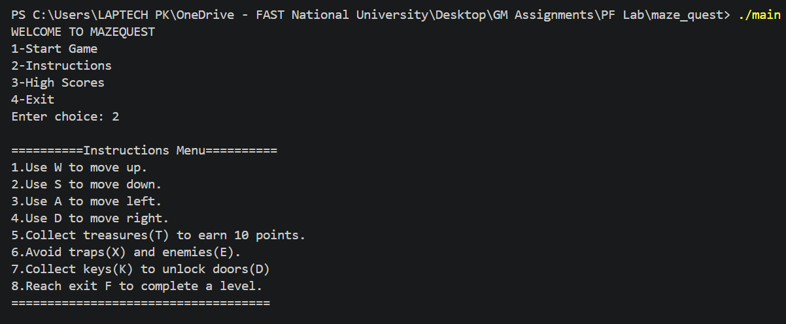
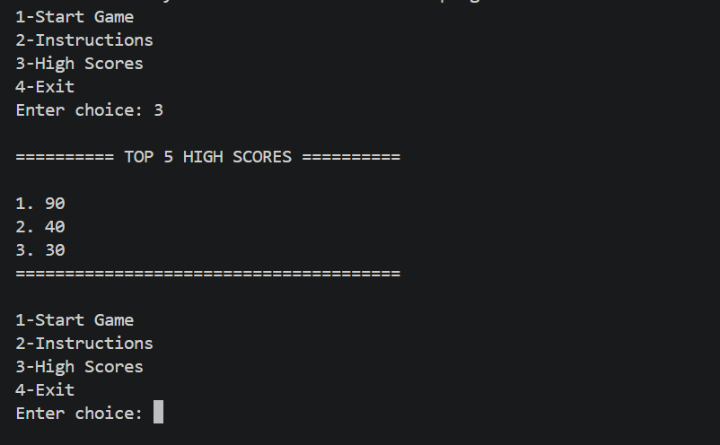
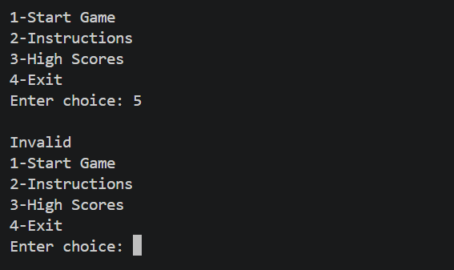

# MazeQuest – Maze and Treasure Hunt Game

## Section A: Project Introduction

MazeQuest is a console-based maze and treasure hunt game developed using the C programming language. The main objective is to navigate through three different maze levels, collect treasures, avoid traps and enemies, find keys, unlock doors, and reach the exit. The game includes player health, three lives, a scoring system, keyboard-based movement, instructions, and a high-score system that stores scores in a text file.

## Section B: Features & Test Cases (Execution Scenarios)

### Case 1: Main Menu and Instructions

- **Description:** Tests the main menu and the instructions displayed to the player.
- **Inputs:** Select menu option `2`.
- **Expected Output:** The game displays its instructions, including movement controls and game rules.
- **Screenshot:**



### Case 2: High Score System

- **Description:** Tests reading, sorting, and displaying saved high scores.
- **Inputs:** Select menu option `3`.
- **Expected Output:** The game reads scores from `highscores.txt`, sorts them in descending order, and displays up to five highest scores.
- **Screenshot:**



### Case 3: Invalid Menu Input

- **Description:** Tests how the program handles an invalid menu selection.
- **Inputs:** Enter an unsupported menu option such as `9`.
- **Expected Output:** The game displays an invalid-choice message and allows the user to return to the menu.
- **Screenshot:**



### Additional Gameplay Scenarios

- **Player Movement:** Use `W`, `A`, `S`, and `D` to move through the maze.
- **Wall Collision:** Attempt to move into a wall. The game displays a message that the player cannot cross the wall.
- **Treasure Collection:** Move onto a treasure tile (`T`). The score increases by 10.
- **Trap and Enemy:** Encounter a trap (`X`) or enemy (`E`). The player's health decreases.
- **Key and Door:** Collect a key (`K`) and use it to unlock a door (`D`).
- **Level Completion:** Reach the exit (`F`) to complete the current level.
- **Game Over:** Lose all three lives. The game ends and saves the score.

## Instructions to Clone and Execute

### Step 1: Clone the Repository

Open Command Prompt or a terminal and execute:

```bash
git clone https://github.com/gmustafa2909/maze_quest.git
```

### Step 2: Compile the Code

Open the cloned repository folder and execute:

```bash
gcc main.c -o main
```

### Step 3: Run the Program

**Windows (Command Prompt):**

```bash
main.exe
```

**Linux/macOS:**

```bash
./main
```

Make sure `highscores.txt` is present in the same directory when running the program.

## Submission Checklist

- Repository visibility is set to Public.
- Source code is named `main.c`.
- `highscores.txt` is included.
- README.md contains the required sections.
- Screenshots are included in the screenshots folder.
- The program compiles successfully using GCC.
- Repository link is ready for submission.
